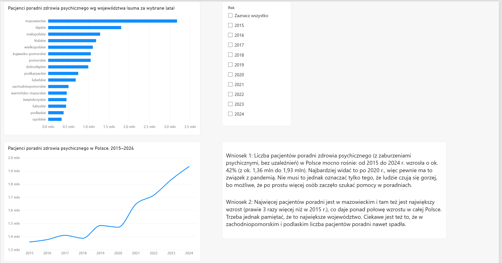
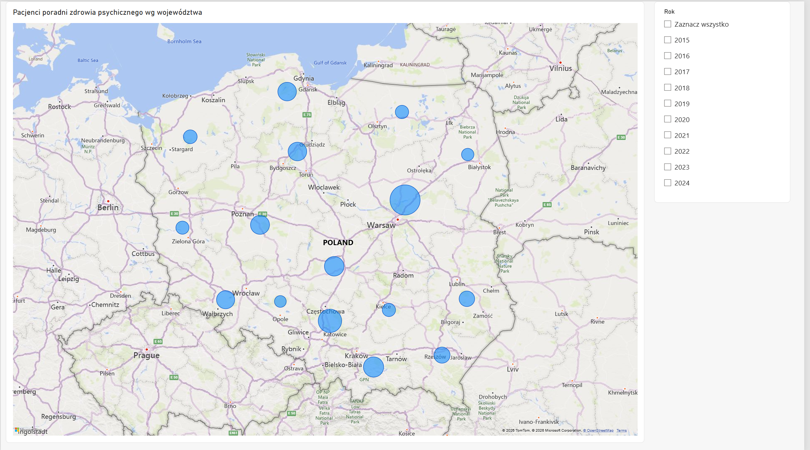

# Mental Health Clinic Patients in Poland – Regional Analysis 2015–2024

Power BI report analysing the number of patients treated in outpatient mental health clinics across Poland's 16 voivodeships (regions) between 2015 and 2024, based on open data from Statistics Poland (GUS).

## Questions

- How has the number of mental health clinic patients in Poland changed over the last decade?
- Did the trend change after 2020?
- Which voivodeships have the most patients, and where is the growth concentrated?

## Data

**Source:** [GUS – Local Data Bank (BDL)](https://bdl.stat.gov.pl), licensed under CC BY 4.0
**Path:** Health care, social assistance and family benefits → Health status of the population → *Patients treated in mental health, addiction treatment and psychoactive substance prevention clinics*
**Variable:** mental and behavioural disorders (excluding alcohol and psychoactive substance use disorders), total – number of persons
**Scope:** 16 voivodeships, 2015–2024

The raw export is included in this repository: `gus_bdl_mental_health_clinics_raw.csv`.

## Data preparation (Power Query)

The raw CSV export required several cleaning steps:

1. Imported the CSV with UTF-8 encoding and semicolon delimiter (auto-detection failed)
2. Removed the unit code column, the empty 2025 column (data not yet published by GUS) and an empty trailing column created by a double delimiter
3. Removed the national total row (*POLSKA*) to keep only the 16 voivodeships
4. **Unpivoted** 10 year columns into a long format (Voivodeship, Year, Patients) → 160 rows
5. Extracted the year from long column headers (e.g. `…total;2015;[person]` → `2015`) using *Text Between Delimiters*
6. Renamed columns, set data types (text, whole numbers)
7. Converted voivodeship names from upper case to lower case, as used in Polish
8. Set the data category *State or Province* so that the map geocodes regions correctly

## Report features

- Bar chart of patients by voivodeship
- Line chart showing the national trend 2015–2024
- Year slicer with multi-select (synchronised across pages)
- Bubble map of patients by voivodeship
- Text box with key conclusions

## Key insights

- The number of mental health clinic patients in Poland grew by about **42%**, from **1.36M (2015)** to **1.93M (2024)**.
- Growth accelerated after 2020: **+8%** between 2015 and 2020, but **+31%** between 2020 and 2024, likely linked to the COVID-19 pandemic.
- **Mazowieckie** (Warsaw region) nearly **tripled** its number of patients (186K → 514K) and accounts for **about 57% of the national increase**.
- In **zachodniopomorskie** and **podlaskie** the number of patients actually **decreased** (by about 18% and 8%).

## Limitations

- The data covers **outpatient clinics only**: it excludes hospital treatment, private practices outside the public reporting system and people who do not seek help.
- Values are **absolute numbers**, not rates per population, so larger regions naturally have more patients.
- An increase in patients may reflect **better access to care and lower stigma**, not only worsening mental health.

## Tools

Power BI Desktop · Power Query · data cleaning · unpivoting · geospatial visualisation

## Context

Built as part of a data analytics course (Power BI). Data: Statistics Poland (GUS), Local Data Bank, CC BY 4.0. The report interface is in Polish.
